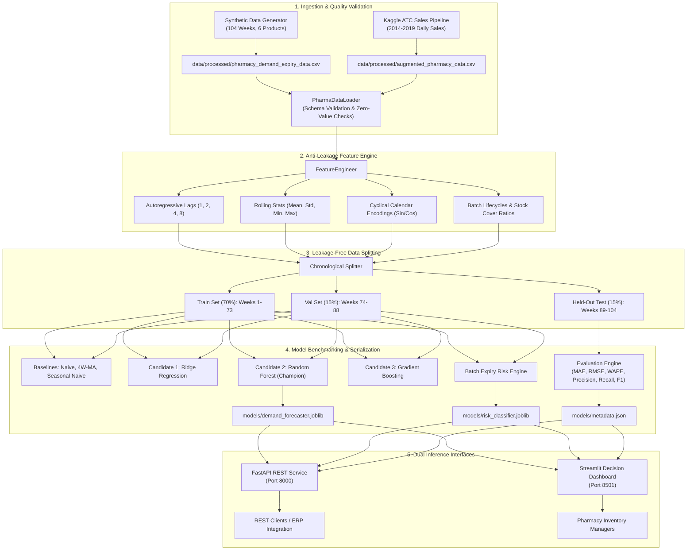
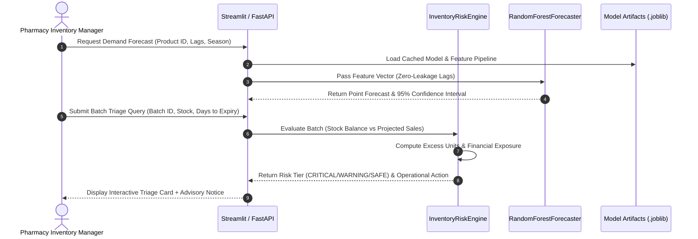

# System Architecture & Technical Specifications
**Algions AI Labs** | Pharmacy Medicine Demand & Expiry-Risk Decision Support System

---

## 1. High-Level System Architecture

The following diagram illustrates the complete end-to-end data preparation, model training, artifact persistence, and dual-interface inference architecture:

---

## 2. Real-Time Inference Sequence Diagram

---

## 3. Data Contracts & Schemas

### 3.1 Weekly Processed Dataset Schema
* `Date` (datetime64): Weekly observation timestamp (Monday).
* `Product_ID` (string): Unique medicine identifier (e.g., `PROD_001`).
* `Product_Name` (string): Clinical commercial title (e.g., `Amoxicillin 500mg`).
* `Category` (string): Pharmacological therapeutic class (e.g., `Antibiotic`).
* `Unit_Price` (float): Unit acquisition cost in USD.
* `Batch_ID` (string): Unique lot batch identifier (e.g., `BAT_001_101`).
* `Manufacture_Date` (datetime64): Release date from manufacturing facility.
* `Expiry_Date` (datetime64): Regulatory expiration date.
* `Initial_Stock` (integer): Total units produced in lot batch.
* `Units_Sold` (integer): Actual physical units dispensed during week.
* `Stock_Balance` (integer): Non-negative units remaining on shelf.
* `Days_To_Expiry` (integer): Calendar days remaining until expiration.
* `Is_At_Risk` (integer binary): 1 if `Days_To_Expiry <= 60` and `Stock_Balance > 0`.

### 3.2 FastAPI REST Endpoints Contract
* `POST /predict/demand`:
  - Request: `{"product_id": "PROD_001", "month": 11, "demand_lag_1": 68.0, "rolling_mean_4": 64.0, ...}`
  - Response: `{"product_id": "PROD_001", "forecasted_demand": 71.4, "confidence_interval_95": {"lower": 62.8, "upper": 80.0}, ...}`
* `POST /batches/risk-assessment`:
  - Request: `{"batch_id": "BAT_001_CRIT", "stock_balance": 420, "days_to_expiry": 30, ...}`
  - Response: `{"risk_tier": "CRITICAL", "projected_waste_units": 355.7, "estimated_capital_at_risk": 4446.25, "recommended_action": "...", "disclaimer": "..."}`
