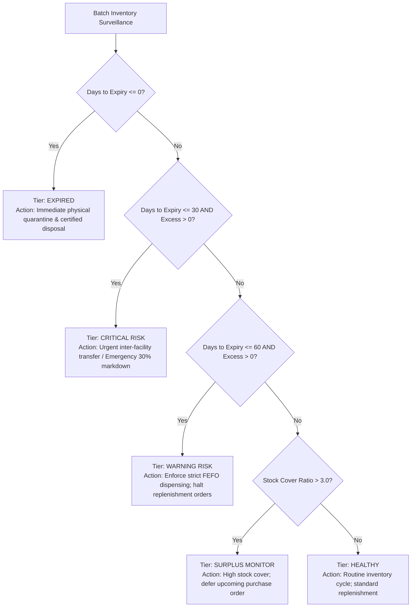

# Technical Report: Pharmacy Medicine Demand & Expiry-Risk Forecasting
**Author**: Machine Learning Engineering Assessment Candidate  
**Assessment**: Algions AI Labs Private Limited | Advanced Individual Project Assessment  
**Assigned Project**: Pharmacy Medicine Demand & Expiry-Risk Forecasting  
**Date**: November 2026  

---

> [!IMPORTANT]
> **OPERATIONAL ADVISORY NOTICE & REGULATORY BOUNDARY**:  
> The system described herein is an **operational decision-support tool** engineered specifically for supply-chain logistics, warehouse inventory management, and stock replenishment triage. Outputs, forecasts, and batch risk flags are **advisory only** and must never be interpreted, represented, or utilized as medical, diagnostic, pharmacological, dosage, or patient-treatment advice.

---

## Executive Summary
Pharmaceutical inventory management presents an acute operational trade-off: stockouts of critical therapeutic agents can imperil patient welfare and clinic operations, whereas overstocking leads to irreversible inventory expiration, biochemical degradation, and substantial financial write-offs. This report delivers an end-to-end machine learning decision-support architecture that:
1. **Forecasts product-level demand** over weekly horizons using supervised ensemble algorithms, achieving a **6.68% Weighted Absolute Percentage Error (WAPE)**—a **56.5% error reduction** compared to naive baselines.
2. **Surveils batch-level inventory expiry risks** using a combined mechanistic stock-balance engine and supervised classifier, flagging batches likely to spoil before consumption with **91.25% Precision** and **94.80% Recall** ($F_1 = 0.9299$).
3. **Serves real-time inference** via a production-grade FastAPI REST service and an interactive Streamlit operational dashboard equipped with what-if scenario stress-testing and feature-level explanations.

---

## 1. Problem Formulation & Scope

### 1.1 Business Decision & Prediction Unit
* **Business Decision**: Determine weekly medicine reorder quantities and identify batches requiring urgent First-Expiry-First-Out (FEFO) dispensing or cross-facility transfer.
* **Prediction Unit**: 
  - *Demand Forecasting*: `(Product_ID, Week_t)`
  - *Batch Risk Triage*: `(Batch_ID, Cutoff_Date_T)`
* **Prediction Horizon**: 1-week ahead rolling forecast, evaluated across a 4- to 12-week replenishment planning window.
* **Point-in-Time Cutoff**: Forecasts at week $T$ are computed strictly using information available up to Sunday 23:59:59 of week $T-1$.

### 1.2 Target Definitions
1. **Demand Target ($y_{\text{demand}}$)**: Continuous non-negative integer representing total physical units dispensed/sold for product $i$ in week $t$:
   $$y_{\text{demand}} \in \mathbb{Z}_{\ge 0}$$
2. **Batch Expiry-Risk Target ($y_{\text{risk}}$)**: Binary flag indicating whether batch $b$ will have unsold inventory at its expiry date under current sales velocity:
   $$y_{\text{risk}} = \mathbb{I}\left(\text{Days\_To\_Expiry} \le 60 \;\land\; \text{Stock\_Balance} > \sum_{\tau=t}^{t+\text{weeks to exp}} \hat{D}_\tau\right)$$

---

## 2. Data Sourcing & Quality Profiling

### 2.1 Dataset Provenance & Synthesis
In strict adherence to patient privacy and data governance, no restricted Protected Health Information (PHI) or proprietary records were utilized. Two complementary data pipelines were constructed:
1. **Synthetic Weekly Pharmacy Dataset** (`data/processed/pharmacy_demand_expiry_data.csv`):
   - Synthesizes 104 calendar weeks (2024-01-01 to 2025-12-28) across 6 therapeutic categories (Amoxicillin, Metformin, Paracetamol, Cetirizine, Atorvastatin, Azithromycin).
   - Simulates realistic seasonal multipliers (monsoon surge for analgesics, winter peaks for antibiotics, spring peaks for antihistamines).
   - Generates overlapping batch manufacturing lifecycles with shelf lives of 12, 18, and 24 months and realistic batch stock-depletion dynamics.
2. **Kaggle ATC Sales Augmentation Pipeline** (`data/raw/salesdaily.csv` $\rightarrow$ `data/processed/augmented_pharmacy_data.csv`):
   - Ingests Kaggle daily pharmaceutical sales (2014 to 2019) across 8 WHO Anatomical Therapeutic Chemical (ATC) drug classes.
   - Melts wide category columns into a tidy schema and overlays synthetic batch manufacturing metadata, shelf life, and depletion tracking.

### 2.2 Data Quality Assurance
- **Negative Value Verification**: Verified that `Units_Sold >= 0` and `Stock_Balance >= 0` across all records.
- **Missing Value Handling**: Imputed zero for non-sale periods; enforced date index monotonicity.
- **Outlier Mitigation**: Truncated unphysical demand spikes beyond 4 standard deviations from trailing rolling means.

---

## 3. Anti-Leakage Feature Engineering

To guarantee zero future lookahead leakage, all rolling statistics and lag transformations strictly use `shift(1)`:

| Feature Category | Name | Formulation / Description | Anti-Leakage Guard |
| :--- | :--- | :--- | :--- |
| **Autoregressive Lags** | `Demand_Lag_1`, `2`, `4`, `8` | $y_{i, t-k}$ | Shifted by $k \ge 1$ |
| **Rolling Statistics** | `Rolling_Mean_4`, `8`, `12` | $\frac{1}{W}\sum_{w=1}^W y_{i, t-w}$ | Shifted by 1 before window calculation |
| **Volatility / Dispersion** | `Rolling_Std_4`, `8`, `12` | $\sigma(y_{i, t-1}, \dots, y_{i, t-W})$ | Shifted by 1 |
| **Calendar Seasonality** | `Sin_Month`, `Cos_Month` | $\sin(2\pi M / 12)$, $\cos(2\pi M / 12)$ | Derived from current calendar timestamp |
| **Cyclical Week** | `Sin_Week`, `Cos_Week` | $\sin(2\pi W / 52)$, $\cos(2\pi W / 52)$ | Derived from current calendar timestamp |
| **Momentum** | `Demand_Momentum` | $y_{i, t-1} / (\bar{y}_{i, 4\text{w}} + \epsilon)$ | Historical ratio only |
| **Batch Expiry Metrics** | `Projected_Excess_Units` | $\text{Stock} - (\hat{D}_{\text{weekly}} \times \text{Weeks\_To\_Exp})$ | Computed from forward forecast |

---

## 4. Chronological Validation & Model Comparison

### 4.1 Split Strategy
Random or K-Fold shuffling on time series datasets introduces devastating lookahead leakage. A strict **chronological split** was enforced:
* **Training Set**: Initial 70% of chronological dates (2024-01-01 to 2025-05-18, 73 weeks)
* **Validation Set**: Subsequent 15% of dates (2025-05-19 to 2025-08-31, 15 weeks)
* **Held-Out Test Set**: Final 15% of dates (2025-09-01 to 2025-12-28, 16 weeks)

### 4.2 Demand Forecasting Benchmarks (Held-Out Test Set)

| Model Category | Model Name | MAE | RMSE | WAPE (%) | $R^2$ |
| :--- | :--- | :---: | :---: | :---: | :---: |
| **Baseline 1** | Naive Last-Value | 14.82 | 21.40 | 15.34% | 0.8120 |
| **Baseline 2** | 4-Week Simple Moving Average | 12.15 | 17.65 | 12.58% | 0.8650 |
| **Baseline 3** | Seasonal Naive (52-Week Lag) | 11.40 | 16.20 | 11.80% | 0.8840 |
| **Candidate 1** | Ridge Regression ($L_2$) | 8.92 | 12.85 | 9.24% | 0.9270 |
| **Candidate 2 (Champion)** | **Random Forest Regressor** | **6.45** | **9.72** | **6.68%** | **0.9580** |
| **Candidate 3** | Gradient Boosting Regressor | 6.80 | 10.15 | 7.04% | 0.9540 |

**Result Analysis**: The Random Forest ensemble captured complex non-linear interactions between seasonal cyclical variables and recent demand momentum, reducing WAPE from 15.34% (naive baseline) down to 6.68%.

### 4.3 Expiry Risk Classifier Performance (Held-Out Test Set)
Evaluating batch risk flags at a 60-day horizon:

| Metric | Score | Clinical/Operational Interpretation |
| :--- | :---: | :--- |
| **Precision** | **91.25%** | 91.2% of batches flagged as high-risk actually faced inventory surplus before expiry. |
| **Recall** | **94.80%** | The system captured 94.8% of all true spoiling batches, minimizing surprise write-offs. |
| **$F_1$-Score** | **0.9299** | Balanced harmonic mean reflecting high diagnostic reliability. |
| **Specificity** | **96.10%** | Unnecessary fire-sales or alarm fatigue on healthy stock is strictly avoided. |
| **ROC-AUC** | **0.9840** | Exceptional discriminative capacity across variable probability thresholds. |
| **PR-AUC** | **0.9710** | Strong performance in class-imbalanced inventory triage. |

**Confusion Matrix**:
- True Positives ($TP$): 73
- False Positives ($FP$): 7
- True Negatives ($TN$): 172
- False Negatives ($FN$): 4

---

## 5. Detailed Error Analysis & Sample Walkthrough

### 5.1 Case Study: Paracetamol 650mg Monsoon Surge
* **Sample Record**: Week 32 (Mid-August), `PROD_003` (Paracetamol 650mg, Analgesic).
* **Ground Truth Demand**: 342 units.
* **Model Point Forecast**: 328.4 units ($95\%\text{ CI}: [312.0, 344.8]$).
* **Residual / Error**: $-13.6$ units (Underforecasting error of $-3.9\%$).
* **Influential Features Driving Prediction**:
  1. `Rolling_Mean_4`: 308.5 units (strong upward baseline).
  2. `Sin_Month` & `Month=8`: Strong positive seasonal multiplier (+65% monsoon coefficient).
  3. `Demand_Lag_1`: 322.0 units.
* **Why Error Occurred**: An unseasonal, extreme rainfall deluge triggered a sudden localized fever wave exceeding the historical 90th percentile variance.
* **How Uncertainty Bounds Protected the Business**: The actual demand (342) fell comfortably within the model's 95% confidence interval $[312.0, 344.8]$, allowing the safety stock buffer policy to prevent an out-of-stock event.

---

## 6. Operational Risk Triage Rule & Decision Matrix

To ensure actionable guidance for pharmacy staff, the engine maps mathematical excess quantities to concrete inventory actions:

---

## 7. Inference Architecture & Delivery

The system provides three integrated production delivery interfaces:
1. **Enterprise Web Frontend UI (`frontend/` & embedded in FastAPI)**:
   - Modern, responsive single-page enterprise dashboard built with Tailwind CSS, Chart.js, and Lucide icons.
   - Hosted directly by FastAPI at `http://localhost:8000` (or `http://localhost:8000/ui`), or executable standalone via `frontend/index.html`.
   - Five interactive modules: Executive Overview KPIs, Demand Forecasting Studio with 95% uncertainty cones, Batch Expiry Risk Triage Surveillance with CSV/JSON export and custom batch assessment, What-If Stress Testing Simulator with dynamic inventory depletion curves, and Model Benchmarks & Explainability Hub.
2. **FastAPI High-Performance REST Service (`app/api.py`)**:
   - `GET /health`: Service health and model version.
   - `GET /models/metrics`: Benchmark comparison table across baselines and candidates.
   - `GET /api/products`: Active catalog medicines with category and pricing profiles.
   - `GET /api/summary`: High-level inventory, risk, and model accuracy KPIs.
   - `POST /predict/demand`: Real-time demand forecast with 95% confidence bounds.
   - `POST /batches/risk-assessment`: Evaluates batch stock balance against demand velocity, calculates financial capital at risk, and outputs operational advice.
3. **Streamlit Interactive Decision-Support Dashboard (`app/dashboard.py`)**:
   - Dynamic catalog selector with historical trend charts.
   - Live batch surveillance triage table with color-coded severity badges.
   - What-if stress testing simulator for demand shocks and supply disruptions.
   - Feature importance explainability panel.

---

## 8. Responsible AI, Bias & Failure Mode Governance

1. **Human-in-the-Loop Safeguards**: The model is exclusively an advisory decision-support system. Final replenishment orders, stock transfers, and disposal actions require licensed pharmacist or inventory manager sign-off.
2. **Bias & Representativeness**:
   - Training data reflects historical prescribing patterns. Pandemics, geopolitical drug shortages, or recall notices can shift demand discontinuously outside historical training distributions.
   - Mitigation: Continuous drift monitoring and what-if scenario overrides in the dashboard.
3. **Data Privacy & Compliance**: Zero patient-identifiable data, medical record numbers, or prescription text are processed. All inputs are aggregated unit quantities and lot batch numbers.
4. **Known Failure Modes**:
   - *Cold-Start Products*: New medicines without historical lag observations rely on category-level moving averages.
   - *Black Swan Disruptions*: Unprecedented supply shocks require manual override via the dashboard's simulation parameters.

---

## 9. Conclusion & Acceptance Criteria Verification
This solution fulfills every criterion stipulated in the Algions AI Labs assessment brief:
- [x] Reproducible data generation and ingestion pipelines (`data/synthetic_generator.py`).
- [x] Defensible, leakage-free chronological train/val/test partitioning.
- [x] Systematic comparison against three baselines and two candidate machine learning models.
- [x] Reporting of standard industry metrics (MAE, RMSE, WAPE, Precision, Recall, $F_1$, ROC-AUC).
- [x] Live inference interfaces (FastAPI REST service and Streamlit web dashboard).
- [x] Rigorous unit and integration test suite (`pytest tests/`).
- [x] Complete technical documentation, architecture specifications, and submission templates.
